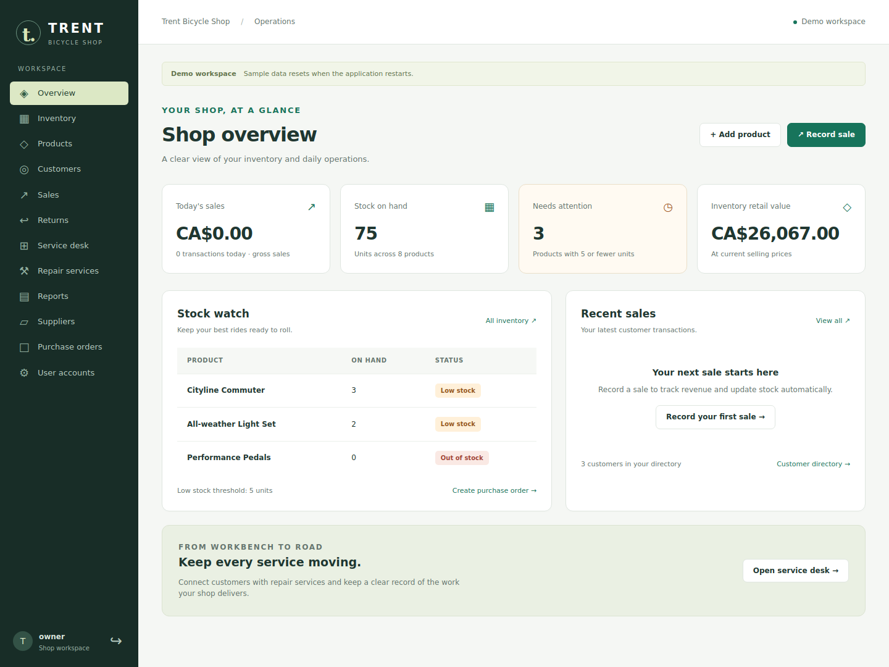

# Trent Bicycle Shop

A Spring Boot application for managing a bicycle shop’s products, inventory, sales, purchasing, returns and repair services. Built by **Manav Patel** with Java 21, Spring Security, Spring Data JPA and Thymeleaf.



## Run the local demo

Install **JDK 21**. Maven is downloaded by the included wrapper; no database installation is needed for the demo.

```bash
git clone https://github.com/ManavvPatel/spring-bicycle-inventory-system.git
cd spring-bicycle-inventory-system
./mvnw spring-boot:run -Dspring-boot.run.profiles=demo
```

Open **http://localhost:8080**. On Windows, use `mvnw.cmd` instead of `./mvnw`.

| Demo role | Username   | Password      |
| --------- | ---------- | ------------- |
| Owner     | `owner`    | `owner123`    |
| Admin     | `admin`    | `admin123`    |
| Employee  | `employee` | `employee123` |

Usernames are lowercase. These accounts are created **only in the `demo` profile**. The demo uses an isolated in-memory H2 database and resets on restart. Never use it for real shop records or connect it to a production database.

## What works

- **Shop overview:** live stock totals, low-stock alerts (five or fewer units), retail inventory value, daily gross sales and recent transactions.
- **Product catalogue:** categories, prices, validation, editing and searchable tables.
- **Sales:** server-calculated prices, positive quantities, stock availability checks and atomic inventory deductions. Product locks prevent simultaneous sales from overselling.
- **Purchasing:** owner-only orders. Mark a shipment received to add stock exactly once; received and cancelled orders cannot be reopened.
- **Returns:** one unit per return, checked against the original sale. Refunds use the recorded sale price; cumulative returns cannot exceed purchased units.
- **Customer and service records:** customer directory, repair catalogue and service transactions.
- **Reports:** inventory by product, retail inventory valuation, daily/weekly/monthly gross sales and weekly repairs.
- **Consistent UI:** responsive navigation, keyboard focus states, local CSS/JavaScript, login feedback, form errors, readable dates and CAD amounts. No CDN is needed at runtime.
- **Access control:** server-side permissions, matching role-aware navigation and CSRF-protected POST actions for deletion and logout.

### Role access

| Area                                      | Employee | Admin | Owner |
| ----------------------------------------- | -------- | ----- | ----- |
| Dashboard, inventory, products, customers | Yes      | Yes   | Yes   |
| Sales, returns, repair services, reports  | Yes      | Yes   | Yes   |
| Suppliers and purchase orders             | No       | No    | Yes   |
| User accounts                             | No       | Yes   | Yes   |

Admins cannot create Owner accounts. Owner accounts and the currently signed-in account cannot be deleted through the UI. New account passwords must contain at least 12 characters.

## Persistent local setup with MySQL

Requires Docker with Compose. Create your local environment file and replace all example passwords:

```bash
cp .env.example .env
docker compose up --build
```

Open http://localhost:8080 and sign in with `BOOTSTRAP_USERNAME` and `BOOTSTRAP_PASSWORD` from `.env`. The initial Owner is created only when the user table is empty; changing the environment later does not reset existing passwords. Categories and order statuses are seeded on startup if missing.

MySQL data persists in the `mysql_data` volume. The database port is not exposed, and the app binds to the local machine. Compose uses `ddl-auto=update` to initialize a development database; use reviewed migrations for production. The Docker build runs the test suite.

For an existing external MySQL database, set `SPRING_DATASOURCE_URL`, `SPRING_DATASOURCE_USERNAME` and `SPRING_DATASOURCE_PASSWORD`. The default schema mode is `validate`, so it will not silently change an existing schema. On a new **development-only** database, use `DDL_AUTO=update` for initialization. Set the application/container timezone to your store’s timezone so daily reports match its business day.

## Run tests and package

```bash
./mvnw verify
java -jar target/bicycleshop-0.0.1-SNAPSHOT.jar --spring.profiles.active=demo
```

The integration suite starts the complete Spring application against a disposable H2 database. It checks authentication, role visibility, protected routes, CSRF requirements, form validation, all main page templates, sale totals, stock rollback, concurrent sale protection, order receipt and return rules. GitHub Actions runs `verify` on Java 21 for pushes and pull requests.

Browser smoke checks are available in `scripts/browser-smoke.cjs`. They require Playwright and an installed Chromium browser, and should **only** run against a fresh demo instance: they create a sale, order, return and service record. See the script header for usage.

## Project structure

```text
src/main/java/com/manav/trentbicycleshop/
  config/       Security and profile-specific initialization
  controller/   Thymeleaf routes, binding, validation and error handling
  model/        JPA entities
  repository/   Database queries and transaction locks
  service/      Sales, stock, orders, returns and other shop operations
src/main/resources/
  static/       Shared local CSS and JavaScript
  templates/    Shared layout and module screens
src/test/       Application integration tests
```

The original academic report is [included in the repository](Manav_Patel_Project2_Part2_Report.pdf). The SQL file under `src/main/resources/db_setup_queries/mysql` is historical reference material, not a migration to run against an existing database.

## Deployment notes and current limits

- Previously committed database credentials and publicly shared account passwords must be rotated before using an existing deployment. Removing them from the current files does not remove them from Git history or an existing database.
- Back up an existing database before updating. Legacy duplicate inventory rows are rejected during stock mutations so that they can be reconciled deliberately.
- `cloudrun` now expects an external MySQL database and uses secure cookies behind HTTPS. Use the explicit `demo` profile for a disposable demo; no profile seeds public demo credentials automatically.
- Returns are one unit per record and assume the returned unit can be restocked. Taxes, payment processing, damaged-stock handling and a full audit log are not implemented.
- Inventory value is **retail selling value**, not accounting cost. Sales reports show gross sales, not net revenue after refunds. Repair history currently reads the service’s catalogue price rather than an immutable historical price.
- Tables filter the records loaded on the page. Large catalogues should add database pagination and search.
- H2 tests do not replace testing against the deployment’s MySQL instance. Verify database compatibility and take backups before deploying.
